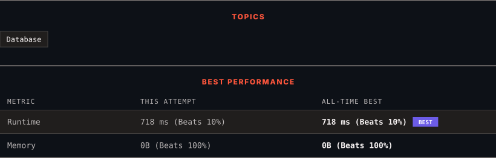

<div align="center">

# 584. Find Customer Referee

      

[](https://leetcode.com/problems/find-customer-referee/)

</div>

---

<div align="center">

<picture>
  <source media="(prefers-color-scheme: dark)" srcset="panel-dark.svg">
  <source media="(prefers-color-scheme: light)" srcset="panel-light.svg">
  
</picture>

</div>

> **New personal best** — Runtime improved on this submission.

### HOW IT WENT

| | |
|:--|:--|
| **Attempts** | 2 before accepted |
| **Time to solve** | 24 min |
| **Verdicts** | ✅ Accepted → ✅ Accepted |

---

### NOTES

_No notes yet._

---

### SOLUTIONS (2)

| # | File | Language | Date |
|:-:|------|:--------:|:----:|
| 1 | [sol1.sql](./sol1.sql) | `MySQL` | 2026-10-27 |
| 2 | [sol2.sql](./sol2.sql) | `MySQL` | 2026-10-27 ← **latest** |

---

### PROBLEM DESCRIPTION

Table: `Customer`

```

+-------------+---------+
| Column Name | Type    |
+-------------+---------+
| id          | int     |
| name        | varchar |
| referee_id  | int     |
+-------------+---------+
In SQL, id is the primary key column for this table.
Each row of this table indicates the id of a customer, their name, and the id of the customer who referred them.

```

 

Find the names of the customer that are either:

	- **referred by** any customer with `id != 2`.

	- **not referred by** any customer.

Return the result table in **any order**.

The result format is in the following example.

 

**Example 1:**

```

**Input:** 
Customer table:
+----+------+------------+
| id | name | referee_id |
+----+------+------------+
| 1  | Will | null       |
| 2  | Jane | null       |
| 3  | Alex | 2          |
| 4  | Bill | null       |
| 5  | Zack | 1          |
| 6  | Mark | 2          |
+----+------+------------+
**Output:** 
+------+
| name |
+------+
| Will |
| Jane |
| Bill |
| Zack |
+------+

```

---

<div align="center">

<sub>Auto-synced by <strong>LeetSync</strong> · Built by <a href="https://deveshsamant.in/">Devesh Samant</a></sub>

</div>
