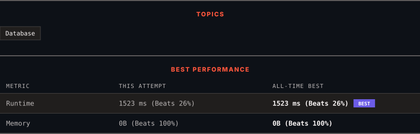

<div align="center">

# 1378. Replace Employee ID With The Unique Identifier

      

[](https://leetcode.com/problems/replace-employee-id-with-the-unique-identifier/)

</div>

---

<div align="center">

<picture>
  <source media="(prefers-color-scheme: dark)" srcset="panel-dark.svg">
  <source media="(prefers-color-scheme: light)" srcset="panel-light.svg">
  
</picture>

</div>

> **New personal best** — Runtime improved on this submission.

### HOW IT WENT

| | |
|:--|:--|
| **Attempts** | first try |
| **Time to solve** | 16 min |
| **Verdicts** | ✅ Accepted |

---

### NOTES

_No notes yet._

---

### SOLUTIONS (1)

| # | File | Language | Date |
|:-:|------|:--------:|:----:|
| 1 | [sol1.sql](./sol1.sql) | `MySQL` | 2026-10-29 ← **latest** |

---

### PROBLEM DESCRIPTION

Table: `Employees`

```

+---------------+---------+
| Column Name   | Type    |
+---------------+---------+
| id            | int     |
| name          | varchar |
+---------------+---------+
id is the primary key (column with unique values) for this table.
Each row of this table contains the id and the name of an employee in a company.

```

 

Table: `EmployeeUNI`

```

+---------------+---------+
| Column Name   | Type    |
+---------------+---------+
| id            | int     |
| unique_id     | int     |
+---------------+---------+
(id, unique_id) is the primary key (combination of columns with unique values) for this table.
Each row of this table contains the id and the corresponding unique id of an employee in the company.

```

 

Write a solution to show the **unique ID **of each user, If a user does not have a unique ID replace just show `null`.

Return the result table in **any** order.

The result format is in the following example.

 

**Example 1:**

```

**Input:** 
Employees table:
+----+----------+
| id | name     |
+----+----------+
| 1  | Alice    |
| 7  | Bob      |
| 11 | Meir     |
| 90 | Winston  |
| 3  | Jonathan |
+----+----------+
EmployeeUNI table:
+----+-----------+
| id | unique_id |
+----+-----------+
| 3  | 1         |
| 11 | 2         |
| 90 | 3         |
+----+-----------+
**Output:** 
+-----------+----------+
| unique_id | name     |
+-----------+----------+
| null      | Alice    |
| null      | Bob      |
| 2         | Meir     |
| 3         | Winston  |
| 1         | Jonathan |
+-----------+----------+
**Explanation:** 
Alice and Bob do not have a unique ID, We will show null instead.
The unique ID of Meir is 2.
The unique ID of Winston is 3.
The unique ID of Jonathan is 1.

```

---

<div align="center">

<sub>Auto-synced by <strong>LeetSync</strong> · Built by <a href="https://deveshsamant.in/">Devesh Samant</a></sub>

</div>
