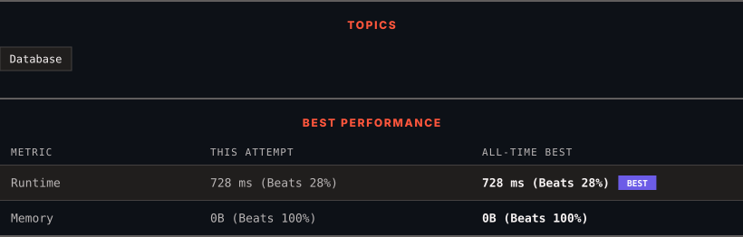

<div align="center">

# 1683. Invalid Tweets

      

[](https://leetcode.com/problems/invalid-tweets/)

</div>

---

<div align="center">

<picture>
  <source media="(prefers-color-scheme: dark)" srcset="panel-dark.svg">
  <source media="(prefers-color-scheme: light)" srcset="panel-light.svg">
  
</picture>

</div>

> **New personal best** — Runtime improved on this submission.

### HOW IT WENT

| | |
|:--|:--|
| **Attempts** | first try |
| **Time to solve** | 7 min |
| **Verdicts** | ✅ Accepted |

---

### NOTES

_No notes yet._

---

### SOLUTIONS (1)

| # | File | Language | Date |
|:-:|------|:--------:|:----:|
| 1 | [sol1.sql](./sol1.sql) | `MySQL` | 2026-10-28 ← **latest** |

---

### PROBLEM DESCRIPTION

Table: `Tweets`

```

+----------------+---------+
| Column Name    | Type    |
+----------------+---------+
| tweet_id       | int     |
| content        | varchar |
+----------------+---------+
tweet_id is the primary key (column with unique values) for this table.
content consists of alphanumeric characters, '!', or ' ' and no other special characters.
This table contains all the tweets in a social media app.

```

 

Write a solution to find the IDs of the invalid tweets. The tweet is invalid if the number of characters used in the content of the tweet is **strictly greater** than `15`.

Return the result table in **any order**.

The result format is in the following example.

 

**Example 1:**

```

**Input:** 
Tweets table:
+----------+-----------------------------------+
| tweet_id | content                           |
+----------+-----------------------------------+
| 1        | Let us Code                       |
| 2        | More than fifteen chars are here! |
+----------+-----------------------------------+
**Output:** 
+----------+
| tweet_id |
+----------+
| 2        |
+----------+
**Explanation:** 
Tweet 1 has length = 11. It is a valid tweet.
Tweet 2 has length = 33. It is an invalid tweet.

```

---

<div align="center">

<sub>Auto-synced by <strong>LeetSync</strong> · Built by <a href="https://deveshsamant.in/">Devesh Samant</a></sub>

</div>
