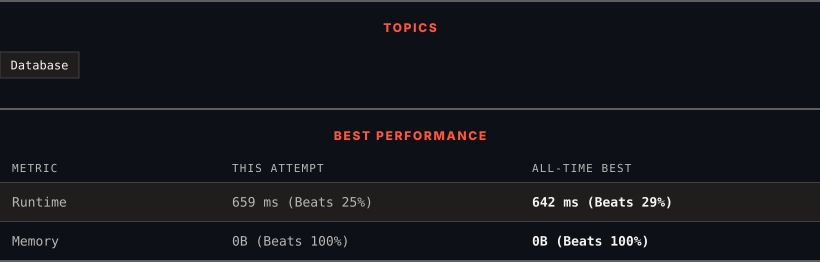

<div align="center">

# 1757. Recyclable and Low Fat Products

      

[](https://leetcode.com/problems/recyclable-and-low-fat-products/)

</div>

---

<div align="center">

<picture>
  <source media="(prefers-color-scheme: dark)" srcset="panel-dark.svg">
  <source media="(prefers-color-scheme: light)" srcset="panel-light.svg">
  
</picture>

</div>

> **New personal best** — Runtime improved on this submission.

### HOW IT WENT

| | |
|:--|:--|
| **Attempts** | 4 before accepted |
| **Time to solve** | 36 min |
| **Verdicts** | ✅ Accepted → ✅ Accepted → ✅ Accepted → ✅ Accepted |

---

### NOTES

_No notes yet._

---

### SOLUTIONS (1)

| # | File | Language | Date |
|:-:|------|:--------:|:----:|
| 1 | [sol1.sql](./sol1.sql) | `MySQL` | 2026-10-25 ← **latest** |

---

### PROBLEM DESCRIPTION

Table: `Products`

```

+-------------+---------+
| Column Name | Type    |
+-------------+---------+
| product_id  | int     |
| low_fats    | enum    |
| recyclable  | enum    |
+-------------+---------+
product_id is the primary key (column with unique values) for this table.
low_fats is an ENUM (category) of type ('Y', 'N') where 'Y' means this product is low fat and 'N' means it is not.
recyclable is an ENUM (category) of types ('Y', 'N') where 'Y' means this product is recyclable and 'N' means it is not.
```

 

Write a solution to find the ids of products that are both low fat and recyclable.

Return the result table in **any order**.

The result format is in the following example.

 

**Example 1:**

```

**Input:** 
Products table:
+-------------+----------+------------+
| product_id  | low_fats | recyclable |
+-------------+----------+------------+
| 0           | Y        | N          |
| 1           | Y        | Y          |
| 2           | N        | Y          |
| 3           | Y        | Y          |
| 4           | N        | N          |
+-------------+----------+------------+
**Output:** 
+-------------+
| product_id  |
+-------------+
| 1           |
| 3           |
+-------------+
**Explanation:** Only products 1 and 3 are both low fat and recyclable.

```

---

<div align="center">

<sub>Auto-synced by <strong>LeetSync</strong> · Built by <a href="https://deveshsamant.in/">Devesh Samant</a></sub>

</div>
